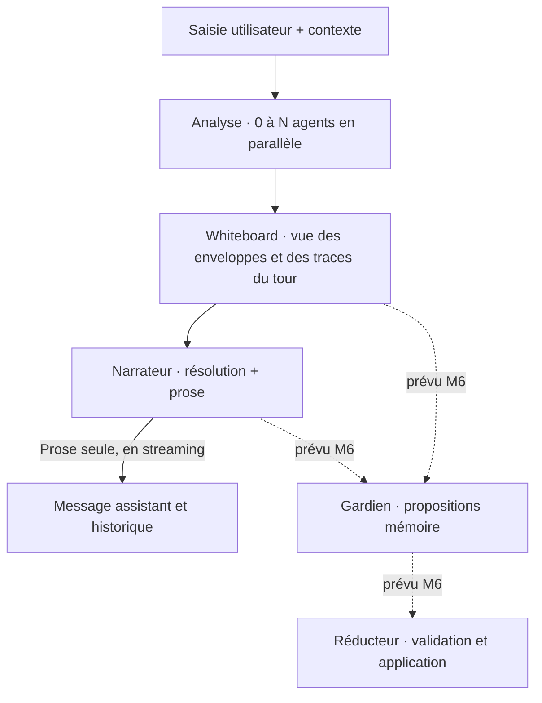

# Choral Writer

Choral Writer est une application de narration interactive à la troisième personne. Chaque projet définit un univers et une équipe d’agents spécialisés, dont les versions sont épinglées au projet. À chaque tour, le chat fait analyser la situation par l’équipe avant de diffuser la réponse du Narrateur.

## Comment fonctionne le pipeline ?

- **Analyse** : chaque agent reçoit le contexte du projet, l’historique récent et la saisie, mais pas les sorties des autres agents. Ses enveloppes JSON sont validées par Zod.
- **Whiteboard** : vue reconstruite à partir des traces et sorties associées à un tour ; ce n’est pas une table dédiée. Les traces conservent notamment les requêtes, réponses, versions d’agents, durées et erreurs.
- **Restitution** : le Narrateur lit le whiteboard et produit une `<resolution>` (les faits) et une `<prose>` (le texte destiné au joueur). Seule la prose est envoyée au chat en SSE.
- **Mémoire** : le Gardien et le Réducteur sont prévus pour M6 ; ils ne font pas encore partie du pipeline exécuté.

### Vocabulaire

| Terme | Sens |
|---|---|
| **Projet** | Univers, prompt système et configuration d’agents. |
| **Agent** | Rôle spécialisé avec des versions d’instructions immuables. |
| **Phase** | `analysis` produit une enveloppe ; `restitution` produit une narration ou, à terme, des propositions mémoire. |
| **Tour** | Une exécution du pipeline pour une saisie. Réessayer ou régénérer crée une nouvelle exécution traçable. |
| **Branche** | Un chemin de conversation ; les branches alternatives partagent leur historique antérieur. |

## Démarrage local

Prérequis : Node.js LTS, pnpm 12 et Docker Desktop pour PostgreSQL.

1. Copier `.env.example` vers `.env`, puis renseigner `APP_PASSWORD`, `COOKIE_SECRET` (32 caractères minimum) et les paramètres du fournisseur LLM.
2. Démarrer PostgreSQL avec `docker compose up -d`.
3. Installer les dépendances : `pnpm install`.
4. Appliquer les migrations : `pnpm db:migrate`.
5. Lancer l’API et le front : `pnpm dev`, puis ouvrir l’URL affichée.

## Commandes

- `pnpm dev` : API et front en développement
- `pnpm build` : build de tous les workspaces
- `pnpm typecheck` : vérification TypeScript
- `pnpm test` : tests Vitest
- `pnpm db:generate` / `pnpm db:migrate` : générer / appliquer les migrations

Pour les conventions de développement, les tests PostgreSQL et la configuration, voir [`docs/DEVELOPMENT.md`](./docs/DEVELOPMENT.md). Les décisions du domaine chat sont dans [`docs/api/CHAT.md`](./docs/api/CHAT.md) et le plan MVP dans [`docs/init/MVP.md`](./docs/init/MVP.md).
