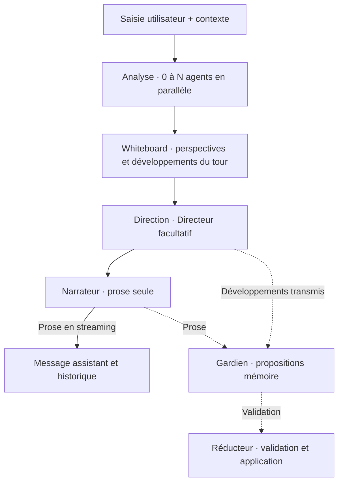

# Choral Writer

Choral Writer est un atelier de narration interactive. Chaque projet définit un univers et une équipe d’agents spécialisés dont les versions sont épinglées au projet. À chaque tour, les agents d’analyse examinent la situation en parallèle, un Directeur facultatif oriente le tour, puis le Narrateur diffuse la prose de la scène en streaming. Le Gardien peut maintenir une mémoire structurée par branche.




## Capacités principales

- Projets avec prompt système et équipe d’agents configurable.
- Conversations en branches, avec réessai et régénération traçables.
- Progression du pipeline en direct et inspection des appels LLM.
- Mémoire de projet modifiable, avec contrôle de lecture par agent.

## Prérequis

- Node.js LTS et pnpm 12.18.
- PostgreSQL pour l’API ; Docker Desktop est facultatif pour le démarrage local.
- Une clé et un modèle compatibles avec l’API Chat Completions d’OpenAI.

## Installation et développement local

1. Copier `.env.example` vers `.env`, puis renseigner les valeurs requises.
2. Installer les dépendances : `pnpm install`.
3. Démarrer PostgreSQL : `docker compose up -d`.
4. Appliquer les migrations : `pnpm db:migrate`.
5. Lancer l’API et le front : `pnpm dev`, puis ouvrir l’adresse Vite affichée (`http://localhost:5175` par défaut).

Les projets ne sont pas préchargés ; créez-en un après connexion pour commencer.

## Configuration

L’API requiert `DATABASE_URL`, `APP_PASSWORD`, `COOKIE_SECRET`, `LLM_API_KEY`, `LLM_BASE_URL` et `LLM_MODEL`. `COOKIE_SECRET` doit contenir au moins 32 caractères. `PORT` est facultatif (3001 par défaut en local) et `NODE_ENV` vaut `development`, `test` ou `production`.

Ne commitez jamais `.env` et ne réutilisez pas les valeurs d’exemple en production. Configurez les secrets dans l’environnement d’exécution.

## Vérification

```sh
pnpm typecheck
pnpm test
pnpm build
```

Les tests PostgreSQL d’intégration utilisent `DATABASE_URL` dans `.env.tests` (fichier local ignoré par Git) et exigent une base jetable. Vitest charge ce fichier automatiquement. Les commandes disponibles et les conventions sont détaillées dans [`docs/DEVELOPMENT.md`](./docs/DEVELOPMENT.md).

## Déploiement

Pour Railway, configurez le build `pnpm build`, la commande de pré-déploiement `pnpm db:migrate`, le démarrage `pnpm start` et le health check `/healthz`. L’API sert le build web sur la même origine ; aucun serveur Vite de développement n’est requis en production. Créez une base PostgreSQL Railway et configurez les variables requises dans Railway. Les détails et limites figurent dans [`docs/DEVELOPMENT.md`](./docs/DEVELOPMENT.md#déploiement-railway).

## Documentation technique

- [`docs/pipeline.md`](./docs/pipeline.md) — étapes, entrées/sorties, erreurs et limites du pipeline actuel.
- [`docs/api/CHAT.md`](./docs/api/CHAT.md) — branches, transactions et invariants du domaine chat.
- [`docs/web/DESIGN_SYSTEM.md`](./docs/web/DESIGN_SYSTEM.md) et [`docs/web/FRONTEND_CONVENTIONS.md`](./docs/web/FRONTEND_CONVENTIONS.md) — interface et conventions frontend.
