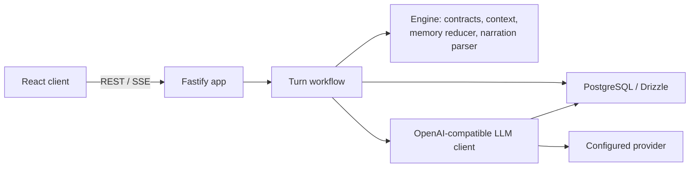

# Architecture

## Shape

Choral Writer is a pnpm monorepo deployed as a modular monolith. `apps/web` is a React/Vite client; `apps/server` is a Fastify API and production static-file host; `packages/engine` contains shared TypeScript contracts and deterministic story rules. PostgreSQL is the persistence boundary.

## Turn flow

The server creates a turn while holding the project lock, then persists progress through interpretation, analysis, narration, and guardian stages. The engine validates structured model output and constructs context. The narrator streams prose; the guardian proposes memory mutations. The server applies accepted mutations and writes the narrative event and projection in a transaction. Traces, proposals, summaries, and turn state are persisted for debugging and recovery.

## Memory and branches

The current implementation stores narrative/mutation events and a JSONB memory projection per branch. The engine reducer applies mutations and can replay them. Rewind creates a child branch at an event cutoff; branch history is assembled from its ancestry. The projection is a derived cache of memory state, not a substitute for the event history.

This is the current implementation, not the normalized entity/fact/knowledge schema described in the original MVP design note. Keep those notes historical. Before extending the memory model, agree on replay/source-of-truth invariants and record any material storage decision in an ADR. Do not normalize preemptively.

## Boundaries

- [apps/server/src/app.ts](../apps/server/src/app.ts) composes Fastify and shared dependencies. Route groups live under `apps/server/src/routes/`; they validate/authenticate and translate requests/responses.
- Turn orchestration lives in `apps/server/src/turns.ts`; `turns/context-data.ts` assembles context/history and `turns/summaries.ts` owns summary compaction.
- Server workflows coordinate persistence, agent calls, budget checks, and transactions.
- Engine rules must not depend on Fastify, Drizzle, PostgreSQL, or environment configuration.
- The browser owns presentation and request state, not canonical story state.
- Keep the deployment as a single application until a concrete scaling or reliability requirement justifies another process.

## Important constraints

- Context filtering protects per-character knowledge and private facts. Preserve that boundary across event history, summaries, and prose excerpts.
- Turn status, lock, resume, retry, and budget behavior are observable product behavior.
- LLM messages and responses are stored in the database; treat traces as sensitive user content.
