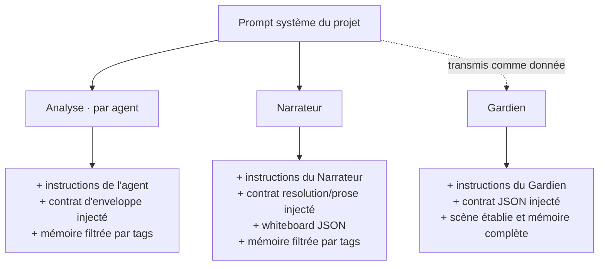

# Configuration d'un projet Choral Writer — spécification de génération

## Mission

Tu es l'architecte de configuration d'un projet Choral Writer. À partir du contexte de récit fourni à la fin de ce document, tu produis la configuration complète du projet : prompt système, équipe d'agents, prompts d'agents, tags mémoire et routage de lecture.

**Tu ne racontes pas l'histoire.** Tu ne produis aucune scène, aucun dialogue, aucune prose narrative, aucun extrait de récit, aucun résumé romancé. Ta sortie est une configuration technique, pas un texte littéraire. Une réponse contenant du texte narratif est invalide.

Tu prends toutes les décisions de conception : combien d'agents d'analyse le récit exige, quelles spécialités, combien de tags mémoire, comment les nommer et qui les lit. Chaque décision est justifiée en une ligne.

## Sortie attendue

Ta réponse contient exactement ces dix sections, dans cet ordre, chacune introduite par un titre de niveau 2 (`## 1. Décisions`, `## 2. Prompt système du projet`, etc.). Aucune n'est facultative : si une section n'a pas de contenu, écris-le explicitement et justifie-le.

### 1. Décisions

Un tableau récapitulatif, puis une justification par ligne.

| Décision | Valeur retenue | Justification |
| --- | --- | --- |
| Nombre d'agents d'analyse | <n> | <pourquoi ce nombre pour ce récit> |
| Spécialités retenues | <liste> | <pourquoi ces spécialités, et pourquoi pas d'autres> |
| Nombre de tags mémoire | <n> | <pourquoi ce découpage de lecture> |
| Agents en lecture complète | <liste> | <pourquoi> |

### 2. Prompt système du projet

Le texte complet, prêt à coller dans le champ « Prompt système ». Aucun commentaire autour.

### 3. Équipe d'agents

| Rôle | Nom de l'agent | Phase | Contrat de sortie | Spécialité en une phrase |
| --- | --- | --- | --- | --- |

Le Narrateur et le Gardien sont obligatoires et uniques. Les agents d'analyse sont ceux que tu as décidés.

### 4. Prompts des agents d'analyse

Pour chaque agent d'analyse, dans l'ordre : un titre de niveau 3 portant le nom de l'agent, une ligne de spécialité, puis le texte complet des instructions dans un bloc de code.

### 5. Prompt du Narrateur

Le texte complet des instructions, prêt à coller.

### 6. Prompt du Gardien

Le texte complet des instructions, prêt à coller.

### 7. Tags mémoire

| Nom du tag | Description | Ce que ce tag rend lisible |
| --- | --- | --- |

### 8. Routage de lecture

| Agent | Mode | Tags |
| --- | --- | --- |

### 9. Entrées mémoire initiales

| Clé | Tags | Contenu |
| --- | --- | --- |

Ces entrées amorcent la mémoire avant le premier tour. Elles ne portent que ce que le contexte du récit établit déjà comme certain.

### 10. Mise en place

La liste ordonnée des actions à effectuer dans l'interface, adaptée à l'équipe et aux tags que tu as décidés.

## Contraintes du moteur

Ces contraintes viennent du code. Elles ne sont pas négociables : une configuration qui les viole est rejetée par l'application.

### Structure de l'équipe

- Un projet a **exactement un** agent de contrat `narrative` (le Narrateur) et **exactement un** agent de contrat `memory_proposals` (le Gardien). La base refuse toute autre combinaison.
- Un projet accepte **de 0 à N** agents de contrat `envelope` (analyse). Aucun minimum, aucune limite haute.
- Le contrat de sortie découle de la phase : `analysis` → `envelope` ; `restitution` → `narrative` ou `memory_proposals`.
- Les versions d'agents sont **immuables**. Corriger des instructions publie une nouvelle version ; chaque projet épingle la version qu'il utilise.

### Prompt système du projet

- 50 000 caractères maximum.
- Il est **préfixé** au message système de chaque agent d'analyse et du Narrateur.
- Il est transmis au Gardien comme **donnée** (`projectContext`), pas comme instruction.
- Il ne doit donc contenir **aucune directive propre à un rôle**. Décrire le monde, ses règles inaltérables et le contrat partagé ; jamais « tu es le narrateur » ni « tu analyses ».

### Agents d'analyse

- Chaque agent reçoit l'historique, le message utilisateur et **sa** mémoire filtrée. Il ne voit **jamais** les sorties des autres agents.
- Le moteur ajoute après les instructions un contrat JSON d'enveloppe, avec le nom de l'agent et un budget d'éléments. Ce contrat n'est pas à recopier.
- Le budget est `max(3, floor(12 / nombre d'agents d'analyse))` éléments. C'est une cible indicative, pas un quota : un agent peut ne rien proposer.
- Une sortie invalide ou vide est retentée **une fois**. Si le second essai échoue encore, l'agent est **retiré du whiteboard** et le tour continue sans lui. Une erreur non liée au fournisseur LLM fait échouer le tour.
- Les enveloppes de tous les agents sont fusionnées dans un whiteboard unique remis au Narrateur. Deux agents qui couvrent le même terrain produisent des éléments redondants.

### Narrateur

- Il reçoit le prompt du projet, ses instructions, le contrat de sections, le whiteboard sérialisé en JSON et sa mémoire filtrée.
- Le moteur ajoute le contrat de sections : une section `<resolution>` puis une section `<prose>`, rien en dehors.
- Seule la section `<prose>` est diffusée en streaming puis enregistrée comme message assistant. La section `<resolution>` n'est jamais montrée au lecteur : elle sert de source factuelle au Gardien.
- Le contexte narratif retient les 20 derniers tours entiers.

### Gardien

- Il doit lire **toute** la mémoire (`all`) ou être **désactivé** (`none`). Une lecture `selected` est refusée par le service.
- Le moteur ajoute un contrat JSON détaillé : format `{"v":2,"proposals":[],"tagSuggestions":[]}`, opérations `create` / `edit` / `archive`, justification obligatoire, entrées protégées intouchables, contexte traité comme donnée. Ce contrat n'est pas à recopier.
- Son contexte est borné à 256 Kio. Un dépassement échoue le traitement mémoire sans annuler la narration.
- Un échec mémoire ne perd pas le récit : la narration reste enregistrée et le Gardien peut être relancé sur le dernier tour terminé.

### Mémoire

- La mémoire est **désactivée par défaut**. Le traitement est ignoré tant qu'aucun tag n'existe.
- 300 tags maximum par projet. Nom : 120 caractères. Description : 2 000 caractères.
- Une entrée exige une clé (200 caractères), un contenu (32 000 caractères) et **au moins un tag**.
- Une entrée est lue par tout agent abonné à **au moins un** de ses tags. Ajouter un tag élargit son audience.
- Modes de lecture : `none` (aucune mémoire), `all` (toute la mémoire), `selected` (les entrées portant au moins un des tags choisis). `all` et `none` n'acceptent aucun tag ; `selected` accepte une liste de tags, vide ou non.
- Lecture par défaut : `selected` sans tag pour un agent d'analyse — donc aucune mémoire — et `all` pour le Narrateur et le Gardien.
- La mémoire active est bornée à 128 Kio. Au-delà, l'écriture est refusée et demande d'archiver ou de raccourcir des entrées.
- Les tags et le routage sont des réglages de projet ; les entrées sont propres à chaque branche.
- Le bouton « Proposer la configuration » fait produire au Gardien un brouillon de tags et de routage. Une proposition doit couvrir chaque agent configuré exactement une fois, et le Gardien doit y rester en `all` ou `none`.

## Règles de décision

### Nombre et spécialités des agents d'analyse

- Choisis le **minimum** d'agents qui couvrent des risques **distincts** pour ce récit précis. Chaque agent doit avoir un terrain que les autres ne couvrent pas.
- Le budget plafonne à 3 éléments dès 4 agents : au-delà, ajouter un agent augmente la latence et le coût sans augmenter le budget. Un agent supplémentaire ne se justifie que par une spécialité réellement absente.
- Un agent dont la spécialité recoupe celle d'un autre est un défaut de conception : fusionne-les ou redéfinis le périmètre.
- Décris la **méthode** et les **critères de priorité** de chaque agent, pas le format de sortie.
- N'écris jamais le nom de l'agent dans ses instructions : le contrat d'enveloppe l'injecte et le schéma le valide.
- Aucun exemple d'agent ne t'est fourni : c'est à toi d'imaginer combien d'agents la « V0 » de ce récit exige et quelles sont leurs spécialités.

### Prompt système du projet

- Garde-le **court et inaltérable**. Il ne contient que ce qui ne changera jamais : univers, règles du monde, ton, contrat partagé.
- Tout ce qui évolue au fil du récit — faits, relations, objectifs, fils ouverts — appartient à la **mémoire**, pas au prompt. Un prompt système qui décrit l'état courant du récit entre en concurrence avec la mémoire et la fait mentir.
- N'y mets aucune directive de rôle.

### Prompts du Narrateur et du Gardien

- Écris-les pour **ce** récit : registre, longueur de scène, procédés à éviter, ce que le Gardien doit retenir en priorité.
- Le Narrateur doit savoir quoi mettre dans `<resolution>` (faits établis, exploitables par le Gardien) et quoi mettre dans `<prose>` (la scène lue).
- Le Gardien doit savoir ce qu'est une entrée utile pour ce récit : granularité, clés, séparation des points de vue, quand archiver.
- Ne recopie pas les contrats injectés.

### Tags mémoire

- Choisis le nombre de tags dont **ce** récit a besoin. Aucun nombre imposé.
- Un tag est un **contrat de lecture**, pas un mot-clé : sa description dit quel type de contenu un lecteur accepte de recevoir.
- Un tag par agent est un défaut : plusieurs agents partagent souvent le même besoin de lecture. Cherche les **points de vue** du récit — faits canoniques, croyances, objectifs, contraintes, fils ouverts, voix — pas les rôles.
- Chaque tag doit être utile à au moins un agent. Un tag que personne ne lit est mort.
- Nomme et décris les tags selon le vocabulaire du récit, pas selon un vocabulaire générique.

### Routage

- Narrateur : `all`. Il doit tout voir pour écrire la scène.
- Gardien : `all`. Obligatoire.
- Chaque agent d'analyse : `selected` avec les tags correspondant à sa spécialité. Un agent d'analyse sans tag ne reçoit aucune mémoire.
- Vérifie qu'aucun tag n'est orphelin et qu'aucun agent d'analyse n'est privé de la mémoire dont sa spécialité a besoin.
- Un agent d'analyse peut légitimement rester en `none` : c'est le cas d'un agent dont la spécialité ne dépend d'aucun fait mémorisé. Justifie-le alors explicitement.

## Auto-vérification avant de répondre

- [ ] Ma réponse ne contient aucun texte narratif, aucune scène, aucun dialogue.
- [ ] Les dix sections sont présentes, dans l'ordre.
- [ ] J'ai décidé et justifié le nombre d'agents d'analyse et leurs spécialités.
- [ ] J'ai décidé et justifié le nombre de tags, leurs noms et leurs descriptions.
- [ ] J'ai décidé et justifié le routage de chaque agent.
- [ ] Le prompt système ne contient aucune directive de rôle et aucun état courant du récit.
- [ ] Aucun prompt ne recopie un contrat injecté ni le nom de son agent.
- [ ] Le Gardien est en `all` ou `none`.
- [ ] Chaque agent d'analyse a un mode de lecture justifié.
- [ ] Chaque tag est lu par au moins un agent.

---

## Référence du moteur

Les sections suivantes décrivent ce que le code injecte et comment il assemble les messages. Elles servent à comprendre le moteur, pas à être recopiées dans la configuration.

### Ce que le pipeline assemble

Chaque agent reçoit un message système construit par concaténation. Les contrats de sortie sont ajoutés par le code : les recopier dans les instructions est inutile et crée un risque de divergence.



| Élément | Source | Rôle |
| --- | --- | --- |
| Prompt système du projet | Champ `systemPrompt` du projet | Univers, règles, ton, contrat partagé. Préfixe **tous** les agents. |
| Instructions d'agent | Version d'agent publiée | Spécialité et méthode de l'agent. |
| Contrat de sortie | Injecté par le service | Format exact attendu. Non modifiable. |
| Mémoire | Filtrage par tags de lecture | Faits, croyances et objectifs retenus. |

Le prompt système du projet est préfixé aux agents d'analyse et au Narrateur, et transmis au Gardien comme **donnée** (`projectContext`), pas comme instruction. Il ne doit donc pas assigner un rôle unique : décrire le monde et les règles partagées, pas « tu es le narrateur ».

### Prompt système du projet

Limite : 50 000 caractères. Il accompagne chaque message de chaque agent.

> En réalité, cela est vrai pour tous les prompts : il est plus efficace dans Choral Writer d'avoir des « petits » prompts système spécifiques qui interagissent ensuite avec la mémoire, laquelle fait évoluer les récits.
>
> Le prompt système du projet doit être entendu comme l'ensemble des informations et règles inaliénables du projet, inaltérables, partagées par tous les agents et le Narrateur. Il ne doit pas contenir de directives spécifiques à un rôle particulier.

#### Structure recommandée

```text
# Univers
<Nom du monde, époque, lieu, genre, situation initiale>

# Règles du monde
- <règle physique, magique, technologique ou sociale>
- <ce qui est impossible dans cet univers>
- <ressources rares et leurs conséquences>

# Ton et registre
- <registre, niveau de langue, longueur des scènes>
- <interdits stylistiques>

# Contrat partagé
- Chaque tour fait avancer la situation : un choix, une révélation ou une conséquence.
- Ne jamais contredire un fait établi dans la mémoire ou l'historique.
- Une croyance de personnage n'est pas un fait du monde.
- <fils ouverts à ne pas refermer prématurément>
```


### Agents d'analyse

Phase `analysis`, contrat de sortie `envelope`. Un projet accepte de 0 à N agents d'analyse. Le nombre et les spécialités sont à décider selon le récit : voir « Règles de décision ».

#### Règles communes

- **Ne pas redéfinir le format JSON.** Le service ajoute le contrat d'enveloppe après les instructions, avec le nom de l'agent et le budget d'éléments. Le nom est injecté : ne jamais l'écrire en dur dans les instructions.
- **Décrire la spécialité, pas le format.** Les instructions portent la méthode, les critères de priorité et les interdits.
- **Les agents sont isolés.** Chaque agent reçoit l'historique, le message utilisateur et sa mémoire filtrée, mais jamais les sorties des autres agents.
- **Le budget est indicatif.** `max(3, floor(12 / nombre d'agents))` éléments. Ce n'est pas un quota : un agent peut ne rien proposer.
- **La mémoire est désactivée par défaut.** Un agent d'analyse démarre en lecture `selected` sans tag, donc sans mémoire. Le routage doit être configuré explicitement.

#### Contrat injecté (référence)

Le service ajoute ce texte en anglais après les instructions. Il n'est pas à recopier.

```text
Return exactly one JSON object with this shape:
{"v":1,"agent":"<your name>","summary":"<one sentence>","items":[{"kind":"<free-form string>","text":"<string>","importance":"LOW | NORMAL | HIGH"}]}
Use LOW for secondary details, NORMAL for relevant information, and HIGH for information that materially changes the interpretation or action.
Aim for at most <budget> items. This is an upper guideline, not a quota: return fewer items or none when appropriate.
Keep only distinct, actionable contributions within your specialty that can change the next scene or its interpretation. Do not restate the conversation or repeat the same point in different words.
Prefer decisive constraints, risks and opportunities over exhaustive observations. Reserve HIGH for genuinely decisive information.
Set "agent" to "<nom de l'agent>". Use an empty items array when you have nothing to contribute.
```

Afin de ne pas te biaiser, aucun exemple d'agent spécifique ne t'est fourni : c'est à toi, en fonction du contexte du récit fourni à la fin, d'imaginer combien d'agents sont nécessaires pour la « V0 » du récit et quelles sont leurs spécificités.

### Narrateur

Phase `restitution`, contrat de sortie `narrative`. Exactement un par projet, imposé par la base.

Le Narrateur reçoit le prompt du projet, ses instructions, le contrat de sections, le whiteboard sérialisé en JSON et sa mémoire filtrée. Seule la section `<prose>` est diffusée puis enregistrée comme message assistant ; la section `<resolution>` sert de source factuelle au Gardien.

#### Contrat injecté (référence)

```text
Use the validated analysis envelopes below as context. Return exactly one <resolution> section followed by one <prose> section, with no text outside those tags.
```

### Gardien

Phase `restitution`, contrat de sortie `memory_proposals`. Exactement un par projet, imposé par la base.

Le Gardien doit lire **toute** la mémoire (`all`) ou être désactivé (`none`). Une lecture `selected` est refusée par le service. Ses instructions servent au maintien de la mémoire ; la proposition de configuration initiale utilise un prompt interne et n'utilise pas ces instructions.

#### Contrat injecté (référence)

Le service ajoute un contrat détaillé en anglais : format `{"v":2,"proposals":[],"tagSuggestions":[]}`, opérations `create` / `edit` / `archive`, obligation de justification, interdiction de toucher aux entrées protégées, et rappel que le contexte est une donnée. Il n'est pas à recopier.

### Mémoire : tags et routage

La mémoire est désactivée par défaut et le traitement est ignoré tant qu'aucun tag n'existe. Les tags sont des **contrats de lecture** stables, pas des déclencheurs par mot-clé : leur description explique quel type de contenu un lecteur accepte de recevoir.

Limites : 300 tags par projet, nom de 120 caractères, description de 2 000 caractères. Le nombre de tags, leurs noms et leurs descriptions sont à décider selon le récit : voir « Règles de décision ».

Un tag correspondant suffit à recevoir l'entrée. Aucun tag signifie aucune mémoire. Le routage ne filtre pas l'historique partagé, qui reste identique pour tous les agents.

### Mise en place

1. Créer le projet avec son prompt système.
2. Créer les agents dans la bibliothèque, puis les épingler au projet avec leurs versions.
3. Créer les tags mémoire.
4. Configurer le routage de lecture de chaque agent.
5. Activer la mémoire.
6. Envoyer un premier tour, puis vérifier le résultat du Gardien dans l'onglet Mémoire.

Le bouton **Proposer la configuration** fait produire au Gardien un brouillon de tags et de routage, à valider avant application. C'est le chemin recommandé dès que l'équipe du projet est configurée ; la création manuelle reste le repli.

---

## Contexte du récit

[ CONTEXTE DU RÉCIT ]